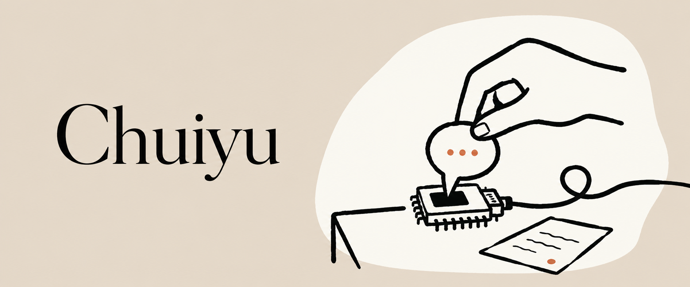

# Chuiyu · ana52070

**让语言连接硬件，让机器人走进现实。** 
**Letting language drive hardware. Putting robots into the real world.**

  
  
  

[中文](#-中文) · [English](#-english)

---

## 🇨🇳 中文

### 我在做什么

嵌入式、AI 与机器人的交叉地带：让大模型调用真实硬件，让机器人在没有地图的校园里自己找路，再把走过的路记成笔记。

### 技术栈

  
  
  
  
  
  

### 精选作品

| 项目 | 做了什么 | 链接 |
| :-- | :-- | :-- |
| **MCP Control STM32** | 通过 MCP 让大模型调用 STM32 上的函数，把对话变成硬件可以执行的动作。 | [仓库](https://github.com/ana52070/MCP_Control_STM32) |
| **校园无地图自主导航** | 围绕 RTK、激光雷达与 ROS2，探索校园环境中的无地图自主导航。 | [仓库](https://github.com/ana52070/carplanning_code) |
| **Chuiyu Wiki** | 把嵌入式、AI 与机器人开发中的实践整理成笔记，留给下一次探索。 | [网站](https://chuiyu.wiki) · [源码](https://github.com/ana52070/chuiyu_Wiki) |

### GitHub 数据

  
  

### 桌边手记

作品之外，过程也值得记录。→ [去我的知识库坐坐](https://chuiyu.wiki)

---

## 🇬🇧 English

### What I do

I work where embedded systems, AI and robotics meet: letting LLMs call real hardware, helping robots find their way around campus without a map, and writing down what I learn along the way.

### Tech stack

  
  
  
  
  
  

### Featured projects

| Project | What it does | Links |
| :-- | :-- | :-- |
| **MCP Control STM32** | Uses MCP so a large language model can call functions on an STM32, turning conversation into actions the hardware can run. | [Repo](https://github.com/ana52070/MCP_Control_STM32) |
| **Campus mapless navigation** | Explores autonomous navigation on campus without a prebuilt map, using RTK, LiDAR and ROS 2. | [Repo](https://github.com/ana52070/carplanning_code) |
| **Chuiyu Wiki** | Notes from embedded, AI and robotics work, kept for the next round of exploration. | [Site](https://chuiyu.wiki) · [Source](https://github.com/ana52070/chuiyu_Wiki) |

### GitHub stats

  
  

### Desk notes

The process is worth keeping, not just the results. → [Sit down in my wiki](https://chuiyu.wiki)

---

Chuiyu · [GitHub](https://github.com/ana52070) / [Wiki](https://chuiyu.wiki)

